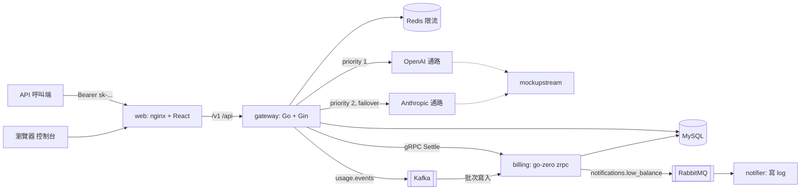

# LLM Gateway

精簡版的 LLM API 閘道。對外提供 OpenAI 格式的 `/v1/chat/completions`，後面接 OpenAI 與 Anthropic 兩種通路，一個通路故障時自動改走另一個。每次呼叫依 token 用量從預付餘額扣款，附開發者控制台與管理後台。

計費拆成獨立的 gRPC 服務，用量紀錄經 Kafka 非同步寫入，餘額不足通知走 RabbitMQ；整套可以用 Docker Compose 或 Helm（kind）起來，並附 k6 壓測與 Lighthouse 前端量測。

Go（Gin、go-zero、gRPC）、MySQL、Redis、Kafka、RabbitMQ、React（Vite）、Docker Compose、Kubernetes（Helm）、k6、GitHub Actions。


## 功能

| 項目 | 內容 |
|---|---|
| 統一入口 | `POST /v1/chat/completions`、`GET /v1/models`，OpenAI 請求與錯誤格式 |
| 多通路與 failover | 通路依 priority 排序；上游 5xx、429、逾時、連線失敗時換下一個通路；上游 4xx 直接回給呼叫端，不切換也不扣款 |
| 跨廠牌轉換 | Anthropic 通路把 OpenAI 請求轉成 Messages API（system 抽出、補 `max_tokens`、`stop_reason` 對回 `finish_reason`），回應轉回 OpenAI 格式 |
| 計費 | 價格以「每 1M tokens 的 micro-USD」存整數；呼叫前預扣估計金額，完成後依實際 usage 結算；餘額不足回 402 |
| 計費服務（gRPC） | 結算交給獨立的 `billing` 服務（go-zero zrpc），提供 `Settle` 與 `GetBalance`，proto 在 `proto/billing.proto` |
| 非同步用量紀錄 | gateway 把每次呼叫的 usage 發到 Kafka，`billing` 批次寫進 MySQL；Kafka 送不出去時 gateway 直接寫 MySQL，不掉資料 |
| 低餘額通知 | 結算後餘額低於門檻，`billing` 發訊息到 RabbitMQ，`notifier` 收到後寫 log；同一個使用者一分鐘最多一則 |
| 限流 | Redis 固定視窗，每把 Key 每分鐘請求數上限，超過回 429 |
| 帳號 | bcrypt 密碼、TOTP 兩步驟驗證、角色分開發者與管理員，session 用 httpOnly cookie 的 JWT |
| API Key | `sk-` 開頭 48 字元，資料庫只存 SHA-256 雜湊，明文只在建立時顯示一次 |
| 控制台 | 申請與停用 Key、使用量（含每日統計）、餘額、儲值、兩步驟驗證設定 |
| 管理後台 | 使用者（角色、停用、調整餘額）、通路、模型價格、全站使用量 |
| 部署 | Docker Compose（開發）、Helm chart（`deploy/helm`，在 kind 上跑過一次 smoke test） |

## 架構



一次 `/v1/chat/completions` 的處理順序：

1. 驗證 API Key（停用的 Key 或停用的帳號回 401）；`last_used_at` 一分鐘內最多寫一次
2. Redis 限流（超過回 429）
3. 檢查模型有沒有價格，依「prompt 字元數 / 4 + max_tokens」估算金額，以條件式 `UPDATE ... WHERE balance >= ?` 原子預扣，扣不到回 402
4. 依 priority 呼叫通路，可重試的錯誤換下一個
5. 依上游回傳的 usage 計算實際金額，透過 gRPC 呼叫 `billing.Settle` 退回或補扣差額；全部通路失敗時全額退回並回 502
6. usage log 以 JSON 發到 Kafka 的 `usage.events`（用 user id 當 key），`billing` 的 consumer 每 500 筆或 200 ms 批次寫入 MySQL，寫入成功才 commit offset
7. `billing` 結算後餘額低於門檻時，發一則訊息到 RabbitMQ 的 `notifications.low_balance`

開發與 demo 一律接 `mockupstream`：同一個程式扮演 OpenAI 與 Anthropic，可以用 `/_control` 切成故障模式，不會呼叫真的模型。

### 服務拆分

* **預扣留在 gateway，結算走 gRPC**：預扣是呼叫前同步、必須立刻知道成不成功的一步，留在 gateway 用單一條件式 `UPDATE`；結算（退回或補扣）交給 `billing`。`billing` 與 gateway 在同一個 Go module，共用 `internal/billing` 的帳本邏輯與同一個 MySQL，只是獨立的執行檔與 image（`backend/Dockerfile.billing`），沒有各自的資料庫
* **兩種模式**：`BILLING_ADDR` 與 `KAFKA_BROKERS` 都沒設時，gateway 退回原本的行為（同步結算、同步寫 usage log），所以單獨跑 gateway 或跑既有測試都不需要其他服務。compose 與 Helm 預設兩者都開
* **結算不被呼叫端中斷**：gRPC 結算用 `context.WithoutCancel` 加 5 秒逾時，呼叫端斷線不會讓預扣的金額卡住
* **用量紀錄是 at-least-once**：consumer 先寫 MySQL 再 commit offset，`billing` 在兩步之間當掉會重複寫入同一批；目前沒有去重鍵，這是刻意接受的取捨（用量表只用來顯示與對帳，餘額另外由結算維護）。要 exactly-once 需要在 usage log 加上事件 id 與唯一索引
* **Kafka 不可用時不掉資料**：producer 非同步批次送出（100 筆或 20 ms），送失敗的那一批由 callback 直接寫 MySQL
* **topic 由 `billing` 啟動時建立**：consumer group 先加入、topic 稍後才被 broker 自動建立時，consumer 收不到資料（kind smoke test 實際踩到過；consumer 另外開了 `WatchPartitionChanges`），所以 `billing` 先 `EnsureTopic`（3 個 partition、replication factor 1，單一 broker）再開始消費
* **proto**：`proto/billing.proto`，生成的程式碼 `backend/internal/billingpb/` 已 commit；改 proto 後跑 `scripts/gen-proto.sh`（用 Docker，不需要本機裝 protoc）

## 快速開始

需要 Docker 與 Docker Compose。

```bash
cp .env.example .env        # 改掉裡面的密碼與 JWT_SECRET
docker compose up -d --build
```

| 服務 | 網址 |
|---|---|
| 控制台 | http://localhost:5173 |
| API 文件（Swagger UI） | http://localhost:5173/docs |
| Gateway | http://localhost:8080 |
| Billing（gRPC） | localhost:8081 |
| 假上游控制 | http://localhost:9000/_control |

Kafka、RabbitMQ 與 notifier 只在 compose 內部網路。管理員帳號是 `.env` 的 `ADMIN_EMAIL` 與 `ADMIN_PASSWORD`。啟動時會自動建立兩個指向 mockupstream 的通路與 `gpt-4o-mini` 的價格（每 1M tokens 輸入 $0.15、輸出 $0.60）。

compose 的 gateway 環境變數可以單獨關掉某一段，方便對照：

| 變數 | 預設 | 說明 |
|---|---|---|
| `BILLING_ADDR` | `billing:8081` | 設成空字串則在 gateway 內同步結算 |
| `KAFKA_BROKERS` | `kafka:9092` | 設成空字串則同步寫 usage log |
| `DB_MAX_OPEN_CONNS` / `DB_MAX_IDLE_CONNS` | 64 / 64 | MySQL 連線池；`DB_MAX_OPEN_CONNS=0` 表示用 Go 預設（不限制上限、只留 2 條閒置） |
| `LAST_USED_INTERVAL` | `1m` | API Key 的 `last_used_at` 最短寫入間隔；`0` 表示每次呼叫都寫 |
| `LOW_BALANCE_THRESHOLD`（billing） | `500000` | 低餘額通知門檻，單位 micro-USD |

例：`BILLING_ADDR= KAFKA_BROKERS= docker compose up -d --force-recreate gateway`

## Demo 步驟

1. 開 http://localhost:5173 註冊帳號，到 Billing 儲值 $5，到 API Keys 建一把 Key 並複製
2. 呼叫 API：

   ```bash
   export GATEWAY_KEY=sk-...
   curl http://localhost:5173/v1/chat/completions \
     -H "Authorization: Bearer $GATEWAY_KEY" -H "Content-Type: application/json" \
     -d '{"model":"gpt-4o-mini","messages":[{"role":"user","content":"Hello"}]}'
   ```

   回應內容是 `[mock-openai] Hello`，Usage 頁多一筆（資料經 Kafka 寫入，可能晚一兩秒），餘額減少。
3. 讓 OpenAI 通路故障，再呼叫一次：

   ```bash
   curl -X POST localhost:9000/_control -d '{"provider":"openai","mode":"500"}'
   ```

   仍然回 200，內容變成 `[mock-anthropic] Hello`，Usage 頁的通路顯示 Anthropic、Failover 欄是 1。改回 `"mode":"ok"` 恢復。`mode` 另有 `timeout`（觸發逾時切換）與 `400`（上游拒絕，不切換）。
4. 用管理員登入，在 Users 把該帳號餘額扣到 0，再呼叫會得到 402 `insufficient_quota`
5. 同一把 Key 一分鐘內第 61 次請求得到 429
6. Security 頁啟用兩步驟驗證，登出再登入時會要求驗證碼
7. 低餘額通知：把 `billing` 的門檻調到 $2 以上，帳號儲值 $1 後呼叫一次，`notifier` 的 log 會出現 `LOW BALANCE ALERT`：

   ```bash
   LOW_BALANCE_THRESHOLD=2000000 docker compose up -d billing
   scripts/events-check.sh     # 註冊、儲值、呼叫一次，確認 usage 列經 Kafka 寫入、notifier 收到通知
   ```

## Kubernetes

`deploy/helm/llm-gateway` 是一個 Helm chart，包含 gateway、billing、notifier、web、mockupstream、MySQL、Redis、Kafka（KRaft 單節點）、RabbitMQ，共 18 個資源。

```bash
helm install llm-gateway deploy/helm/llm-gateway -n llm-gateway --create-namespace \
  --set jwtSecret="$(openssl rand -hex 32)" --set adminPassword="$(openssl rand -hex 12)"
```

* `jwtSecret` 與 `adminPassword` 沒有預設值，沒設會在 `helm template` 就失敗；資料庫與 RabbitMQ 的密碼有開發用預設值，正式環境要改
* Service 名稱固定（`gateway`、`billing`、`mysql`⋯），因為 `web/nginx.conf` 直接 proxy 到 `gateway:8080`，一個 namespace 裝一份
* 每個 Pod 設 `enableServiceLinks: false`：否則 Kubernetes 會注入 `KAFKA_PORT=tcp://...` 之類的環境變數，Kafka image 會把它當成錯誤的 broker 設定
* 啟動順序用 initContainer（`nc -z`）等相依服務；自家 image 以非 root（uid 10001）執行
* MySQL 用 emptyDir，Pod 重排程資料就沒了；這個 chart 的定位是示範與驗證，不是正式環境的資料層
* `lowBalanceThreshold`、各服務資源上限都在 `values.yaml`

驗證：

* CI 的 `helm` job 做 `helm lint --strict` 與 `helm template | kubeconform -strict`（Kubernetes 1.31 schema），工具版本固定並驗 sha256
* `deploy/kind/smoke.sh` 在本機建一個一次性的 kind 叢集（獨立的 kubeconfig，不動預設的），build 並載入四個 image、安裝 chart，經 `web` 的 port-forward 註冊、儲值、建 Key、呼叫 `/v1/chat/completions`，確認 HTTP 200、usage 列經 Kafka 寫入、notifier 收到 RabbitMQ 的低餘額通知，最後刪除叢集。kind 沒有放進 CI（GitHub runner 資源與時間考量），只在本機跑

kind smoke test 的實際結果（本機一次性叢集 `llm-gateway-smoke`，Kubernetes v1.33.1）：9 個 Pod 全部 Running；`POST /v1/chat/completions` 回 HTTP 200、內容 `[mock-openai] Hello from kind`；`/api/usage` 筆數 1（經 Kafka 寫入）；餘額 $1 扣到 $0.999995；notifier log 出現 `LOW BALANCE ALERT user=2 balance=1.0000 USD threshold=2.0000 USD`；腳本印出 `SMOKE OK`，叢集刪除後 `kind get clusters` 回「No kind clusters found」。

第一次跑這個 smoke test 時失敗了：呼叫回 200，但 usage 筆數一直是 0。Kafka log 顯示 `billing` 的 consumer 先加入 group，topic 約 3 秒後才被 broker 自動建立，之後訊息就沒被消費。判斷是 group 加入時 topic 還不存在、沒分到 partition（沒有直接檢視分配結果）。修法是 `billing` 啟動時先建立 topic（見「服務拆分」），修完重跑才通過。

## 壓力測試

`loadtest/chat.js`（k6）對 `/v1/chat/completions` 打 30 秒、64 個虛擬使用者、32 把 Key（每個虛擬使用者固定用一把），上游是 mockupstream。`loadtest/run.sh <label>` 每次先清 usage log、把測試帳號餘額與限流調高，跑完等 usage log 的筆數穩定後印出摘要；`loadtest/bootstrap.sh` 經 API 建立 32 個測試帳號與 Key（`keys.json` 不進 repo）；`loadtest/matrix.sh` 依序套用下面各組設定。原始 k6 輸出在 `loadtest/results/`。

```bash
docker compose up -d --build
loadtest/bootstrap.sh
loadtest/matrix.sh 3            # 每組跑 3 次
```

結果（同一個 build，只用環境變數切換；中位數）：

| 組 | 設定 | 次數 | req/s | p95 | 失敗請求 |
|---|---|---|---|---|---|
| 改動前 | 原本的版本（commit 當時的 HEAD） | 3 | 289 | 297 ms | 3 次中 1 次 3.8% |
| c0 | 新 build，全部關閉（同步結算、同步寫 usage、連線池與 `last_used_at` 維持原樣） | 10 | 289 | 355 ms | 10 次中 2 次（5.4%、6.8%） |
| c1 | c0 + MySQL 連線池 64 | 3 | 353 | 275 ms | 0 |
| c2 | c1 + `last_used_at` 一分鐘最多寫一次 | 3 | 399 | 256 ms | 0 |
| c3 | c2 + usage log 經 Kafka 批次寫入 | 3 | 442 | 201 ms | 0 |
| c4 | c3 + 結算走 gRPC 到 `billing`（預設架構） | 13 | 476 | 170 ms | 0 |

c0 對 c4：req/s 289 到 476（約 1.65 倍），p95 355 ms 到 170 ms（約降 52%）。每組結束後等 consumer 消化完，`usage_logs` 筆數都等於 k6 送出的請求數（0 筆遺失；有失敗請求的那幾次，沒有回 200 的請求不會寫 usage）。

這輪調整做了什麼：

1. **MySQL 連線池**：改動前的 gateway 沒設連線池，`database/sql` 只保留 2 條閒置連線，高併發下每個請求都重新建連線再關掉。改動前版本的一次測試裡，gateway log 有 340 筆 `dial tcp ...:3306: connect: cannot assign requested address`（本機臨時 port 用盡），那次 3.8% 的請求失敗就是這個原因。上限設 64 條並保留閒置連線後，這個錯誤在 c1 以後的所有測試都沒再出現
2. **`last_used_at` 節流**：每個通過驗證的請求原本都對 `api_keys` 寫一次 `last_used_at`，是請求路徑上唯一對 `api_keys` 的寫入。現在只在超過一分鐘沒更新時才寫（只量了整體 req/s 與 p95 的變化，沒有另外分析是鎖還是 I/O 的影響）
3. **usage log 非同步（Kafka）與結算走 gRPC**：把「寫 usage 列」從請求路徑拿掉；結算改由 billing 處理。c4 的增益比前面小，因為 gRPC 多了一次網路往返，換到的是服務邊界，不是純粹的速度

限制，數字請當相對比較看：

* 整套服務與 k6 都在同一台機器（WSL2，15.6 GB 記憶體）上，機器上還有別的專案的容器在跑（測試期間 load average 約 7 到 30），所以絕對值每次都會飄，同一組設定不同批次的 req/s 可以差到 1.5 倍：c4 有一批（最後 build 的第一次，3 次）只有 295 到 350 req/s，隔一陣子再跑就回到 391 到 521。因此 c0 與 c4 補跑了多批取中位數（c0 共 10 次、c4 共 13 次），c1 到 c3 只在第一批跑了 3 次
* 比較要看時間相鄰的批次：c4 與 c0 時間相鄰的每一次比較，c4 都比較高（最後交錯執行 c4、c0、c4、c0 各 2 次，c4 為 391、454、521、483 req/s，c0 為 326、268、323、297 req/s）。c1 到 c3 彼此之間的差距（約 10%）接近單次測試的離散度，只能當趨勢看
* 上游是 mockupstream，沒有真實模型的延遲；每個請求的處理時間幾乎都花在閘道自己與 MySQL
* k6 的原始 JSON 同名會被後一批覆蓋，所以各批的摘要另存在 `loadtest/results/matrix-output.txt`（第一批，c0 到 c4）、`matrix-again-output.txt`（c0、c4 補跑）、`matrix-final-output.txt`（最終 build 的 c4）、`matrix-ab-output.txt`（交錯的 c4、c0）；表中的數字以這些檔案為準，改動前版本的三次在 `head-run*.txt`

## 前端效能

針對 `web/` 做了四件事：

* **程式碼切分**：控制台各頁與管理後台改用 `React.lazy`，登入、註冊與外框維持同步載入。入口檔 JS 從 297,885 B 降到 256,520 B（gzip 後 81,008 B），Security 頁（含 TOTP 與 QR code）27 kB 獨立成一個 chunk
* **gzip**：nginx 對 JS、CSS、JSON、SVG、純文字啟用 gzip（level 6）。之前的版本沒有壓縮，入口 JS 實際傳輸 297,885 B，現在 81,008 B
* **長期快取**：`/assets/` 底下是檔名帶 hash 的檔案，回 `Cache-Control: public, max-age=31536000, immutable`；`index.html` 回 `no-cache`（每次驗證，才能拿到新的 hash 檔名）；`robots.txt` 快取一小時
* **meta 與 robots**：描述性的 `<title>`、`meta description`、`robots`、`theme-color`、Open Graph 標籤與內嵌 SVG favicon；新增 `robots.txt`（之前回的是 SPA 的 `index.html`）

**Brotli 沒有做。** 官方的 `nginx-unprivileged` image 沒有 brotli 模組，要加得換 image 或自己編 nginx，這個專案不值得；`Accept-Encoding: br` 的實測回應沒有 `Content-Encoding`（`docs/lighthouse/after-headers.txt`）。要用 brotli 比較合理的做法是在 CDN 或前面的反向代理做。

量測用 Lighthouse 12.8.2（行動裝置預設，模擬節流），在 Docker 內的 Chromium 對 `http://127.0.0.1:5173/login` 各跑 3 次（`scripts/lighthouse.sh`，單次摘要在 `docs/lighthouse/`）：

| 指標 | 改動前（3 次） | 改動後（3 次） |
|---|---|---|
| Performance | 95 / 94 / 94 | 100 / 100 / 99 |
| Accessibility | 100 / 100 / 100 | 100 / 100 / 100 |
| Best Practices | 96 / 96 / 96 | 96 / 96 / 96 |
| SEO | 82 / 82 / 82 | 100 / 100 / 100 |
| LCP | 2403 / 2553 / 2556 ms | 1504 / 1502 / 1556 ms |
| FCP | 2403 / 2402 / 2404 ms | 1352 / 1352 / 1405 ms |
| TBT | 2 / 0 / 2 ms | 4 / 0 / 4 ms |
| 傳輸大小 | 304,799 B | 84,456 B |

改動前 SEO 只有 82，失敗的審核項是 `robots-txt`（回的是 HTML）與 `meta-description`，這兩項改動後通過。`errors-in-console` 改動前後都沒過（Best Practices 96 的來源），這次沒處理。標頭實測（`scripts/web-headers.sh`）：

| 項目 | 改動前 | 改動後 |
|---|---|---|
| `/assets/*.js` 的 `Cache-Control` | 無 | `public, max-age=31536000, immutable` |
| `/assets/*.js` 的 `Content-Encoding` | 無 | `gzip` |
| `index.html` 的 `Cache-Control` | 無 | `no-cache` |
| `/robots.txt` | `text/html`（SPA fallback） | `text/plain`，`User-agent: *` |

這是對本機 nginx 量的，沒有經過真正的 CDN；快取標頭是 CDN 能生效的前提，但 CDN 本身沒有部署或驗證。Lighthouse 是對 `/login` 一頁，登入後的頁面沒有量。

## 測試

```bash
# 後端：單元與整合測試，使用獨立的測試資料庫（每個測試會清空資料表）
docker compose --profile test up -d mysql-test
cd backend
TEST_MYSQL_DSN='gateway:gatewaypass@tcp(127.0.0.1:3308)/gateway_test?parseTime=true&charset=utf8mb4&loc=UTC' \
  go test -race -p 1 ./...

# 假上游
cd mockupstream && go test ./...

# 端到端（整套 compose 起來後）
cd e2e && npm ci && npx playwright install chromium
set -a && . ../.env && set +a && npx playwright test
```

後端測試涵蓋：

* 併發扣款：20 個請求同時預扣、餘額只夠 5 個，結果恰好 5 個成功、餘額不為負
* failover：上游 500 與逾時會切換，上游 400 不切換且第二個通路收到 0 次請求
* 全部通路故障：回 502、預扣全額退回、usage log 記 502 與成本 0
* TOTP：未完成第二步的 pending token 不能當 session 用
* 權限：一般使用者打每一個管理 API 都是 403；停用的 Key 與帳號立即失效
* 計費服務：結算的退回與補扣、不會把餘額扣成負數、負數與不存在的使用者回錯誤、低餘額通知的節流
* 事件：Kafka 訊息解碼（壞訊息略過）、送不出去時 producer 改寫 MySQL；結算服務失敗時 gateway 仍回 200
* `last_used_at` 的節流

Playwright 端到端在桌面與 390px 手機寬度各跑一次：註冊到呼叫 API 的完整流程（usage 列經 Kafka 非同步寫入，所以測試會重新載入頁面直到它出現）、兩步驟登入、failover、402、一般使用者看不到也打不到管理功能、未登入請求被拒。測試帳號以 `e2e-<runId>-` 開頭，跑完由管理員 API 停用。

GitHub Actions 跑後端（含 MySQL service 與 `-race`）、假上游、前端 lint 與 build、OpenAPI lint、Helm lint 與 kubeconform、Docker image build、gosec 與 Semgrep。

## 設計取捨

* **金額用整數 micro-USD**：避免浮點誤差，成本計算無條件進位到 1 micro-USD
* **預扣再結算**：避免併發請求把餘額扣成負數。`max_tokens` 限 1 到 65536，沒帶時用 1024 並轉給上游，讓輸出不超過預扣；實際用量仍超過預扣時只補扣到餘額歸零，差額記 log，餘額不會小於 0
* **限流 fail-open**：Redis 無法連線時放行請求並記 log，優先維持服務可用；要嚴格限流可改成 fail-closed
* **不支援串流**：`stream: true` 回 400，讓專案範圍集中在路由、計費與權限
* **儲值是模擬付款**：`POST /api/billing/topup` 直接入帳並留紀錄，沒有接金流
* **billing 與 gateway 共用資料庫**：拆成獨立服務是為了示範服務邊界、gRPC 與非同步管線；真正的微服務會各有自己的資料與帳本 API，這裡刻意不做，避免分散式交易
* **用量紀錄 at-least-once**：見上面「服務拆分」

## 安全稽核

gosec 與 Semgrep 的掃描結果與處置見 [docs/security-audit.md](docs/security-audit.md)。

## 目錄

```
backend/        Go 閘道（cmd/gateway、cmd/billing、cmd/notifier；internal/ 依功能分套件）
mockupstream/   假 OpenAI 與 Anthropic 上游
proto/          billing 的 gRPC 定義（生成的程式碼在 backend/internal/billingpb）
web/            React 控制台與 nginx 設定
deploy/         Helm chart（helm/）與 kind smoke test（kind/）
loadtest/       k6 腳本、帳號建立、設定矩陣與原始結果
scripts/        proto 生成、Lighthouse、標頭檢查、事件鏈驗證
e2e/            Playwright 端到端測試
docs/           OpenAPI、稽核報告、截圖、Lighthouse 原始結果
```
