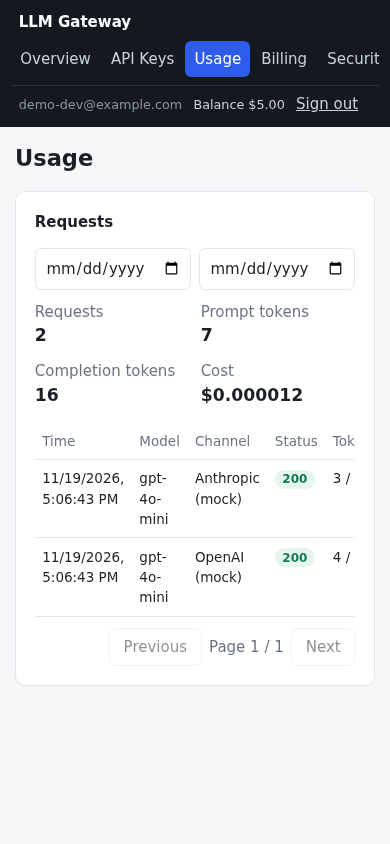
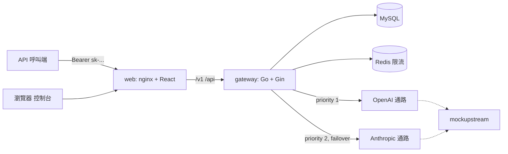

# LLM Gateway

精簡版的 LLM API 閘道。對外提供 OpenAI 格式的 `/v1/chat/completions`，後面接 OpenAI 與 Anthropic 兩種通路，一個通路故障時自動改走另一個。每次呼叫依 token 用量從預付餘額扣款，附開發者控制台與管理後台。

Go（Gin）、MySQL、Redis、React（Vite）、Docker Compose、GitHub Actions。



## 功能

| 項目 | 內容 |
|---|---|
| 統一入口 | `POST /v1/chat/completions`、`GET /v1/models`，OpenAI 請求與錯誤格式 |
| 多通路與 failover | 通路依 priority 排序；上游 5xx、429、逾時、連線失敗時換下一個通路；上游 4xx 直接回給呼叫端，不切換也不扣款 |
| 跨廠牌轉換 | Anthropic 通路把 OpenAI 請求轉成 Messages API（system 抽出、補 `max_tokens`、`stop_reason` 對回 `finish_reason`），回應轉回 OpenAI 格式 |
| 計費 | 價格以「每 1M tokens 的 micro-USD」存整數；呼叫前預扣估計金額，完成後依實際 usage 結算；餘額不足回 402 |
| 限流 | Redis 固定視窗，每把 Key 每分鐘請求數上限，超過回 429 |
| 帳號 | bcrypt 密碼、TOTP 兩步驟驗證、角色分開發者與管理員，session 用 httpOnly cookie 的 JWT |
| API Key | `sk-` 開頭 48 字元，資料庫只存 SHA-256 雜湊，明文只在建立時顯示一次 |
| 控制台 | 申請與停用 Key、使用量（含每日統計）、餘額、儲值、兩步驟驗證設定 |
| 管理後台 | 使用者（角色、停用、調整餘額）、通路、模型價格、全站使用量 |

## 架構



一次 `/v1/chat/completions` 的處理順序：

1. 驗證 API Key（停用的 Key 或停用的帳號回 401）
2. Redis 限流（超過回 429）
3. 檢查模型有沒有價格，依「prompt 字元數 / 4 + max_tokens」估算金額，以條件式 `UPDATE ... WHERE balance >= ?` 原子預扣，扣不到回 402
4. 依 priority 呼叫通路，可重試的錯誤換下一個
5. 依上游回傳的 usage 計算實際金額，退回或補扣差額，寫入 usage log；全部通路失敗時全額退回並回 502

開發與 demo 一律接 `mockupstream`：同一個程式扮演 OpenAI 與 Anthropic，可以用 `/_control` 切成故障模式，不會呼叫真的模型。

## 快速開始

需要 Docker 與 Docker Compose。

```bash
cp .env.example .env        # 改掉裡面的密碼與 JWT_SECRET
docker compose up -d --build
```

| 服務 | 網址 |
|---|---|
| 控制台 | http://localhost:5173 |
| API 文件（Swagger UI） | http://localhost:5173/docs |
| Gateway | http://localhost:8080 |
| 假上游控制 | http://localhost:9000/_control |

管理員帳號是 `.env` 的 `ADMIN_EMAIL` 與 `ADMIN_PASSWORD`。啟動時會自動建立兩個指向 mockupstream 的通路與 `gpt-4o-mini` 的價格（每 1M tokens 輸入 $0.15、輸出 $0.60）。

## Demo 步驟

1. 開 http://localhost:5173 註冊帳號，到 Billing 儲值 $5，到 API Keys 建一把 Key 並複製
2. 呼叫 API：

   ```bash
   export GATEWAY_KEY=sk-...
   curl http://localhost:5173/v1/chat/completions \
     -H "Authorization: Bearer $GATEWAY_KEY" -H "Content-Type: application/json" \
     -d '{"model":"gpt-4o-mini","messages":[{"role":"user","content":"Hello"}]}'
   ```

   回應內容是 `[mock-openai] Hello`，Usage 頁多一筆，餘額減少。
3. 讓 OpenAI 通路故障，再呼叫一次：

   ```bash
   curl -X POST localhost:9000/_control -d '{"provider":"openai","mode":"500"}'
   ```

   仍然回 200，內容變成 `[mock-anthropic] Hello`，Usage 頁的通路顯示 Anthropic、Failover 欄是 1。改回 `"mode":"ok"` 恢復。`mode` 另有 `timeout`（觸發逾時切換）與 `400`（上游拒絕，不切換）。
4. 用管理員登入，在 Users 把該帳號餘額扣到 0，再呼叫會得到 402 `insufficient_quota`
5. 同一把 Key 一分鐘內第 61 次請求得到 429
6. Security 頁啟用兩步驟驗證，登出再登入時會要求驗證碼

## 測試

```bash
# 後端：單元與整合測試，需要 docker compose 的 MySQL
docker compose up -d mysql
cd backend
TEST_MYSQL_DSN='gateway:gatewaypass@tcp(127.0.0.1:3307)/gateway?parseTime=true&charset=utf8mb4&loc=UTC' \
  go test -race -p 1 ./...

# 假上游
cd mockupstream && go test ./...

# 端到端（整套 compose 起來後）
cd e2e && npm ci && npx playwright install chromium
set -a && . ../.env && set +a && npx playwright test
```

後端測試涵蓋：

* 併發扣款：20 個請求同時預扣、餘額只夠 5 個，結果恰好 5 個成功、餘額不為負
* failover：上游 500 與逾時會切換，上游 400 不切換且第二個通路收到 0 次請求
* 全部通路故障：回 502、預扣全額退回、usage log 記 502 與成本 0
* TOTP：未完成第二步的 pending token 不能當 session 用
* 權限：一般使用者打每一個管理 API 都是 403；停用的 Key 與帳號立即失效

Playwright 端到端在桌面與 390px 手機寬度各跑一次：註冊到呼叫 API 的完整流程、兩步驟登入、failover、402、一般使用者看不到也打不到管理功能、未登入請求被拒。測試帳號以 `e2e-<runId>-` 開頭，跑完由管理員 API 停用。

GitHub Actions 跑後端（含 MySQL service 與 `-race`）、假上游、前端 lint 與 build、OpenAPI lint、Docker image build、gosec 與 Semgrep。

## 設計取捨

* **金額用整數 micro-USD**：避免浮點誤差，成本計算無條件進位到 1 micro-USD
* **預扣再結算**：避免併發請求把餘額扣成負數。實際用量超過估計時會補扣，餘額可能短暫小於 0，下一次請求就會被 402 擋下
* **限流 fail-open**：Redis 無法連線時放行請求並記 log，優先維持服務可用；要嚴格限流可改成 fail-closed
* **不支援串流**：`stream: true` 回 400，讓專案範圍集中在路由、計費與權限
* **儲值是模擬付款**：`POST /api/billing/topup` 直接入帳並留紀錄，沒有接金流

## 安全稽核

gosec 與 Semgrep 的掃描結果與處置見 [docs/security-audit.md](docs/security-audit.md)。

## 目錄

```
backend/        Go 閘道（cmd/gateway 進入點，internal/ 依功能分套件）
mockupstream/   假 OpenAI 與 Anthropic 上游
web/            React 控制台與 nginx 設定
e2e/            Playwright 端到端測試
docs/           OpenAPI、稽核報告、截圖
```
